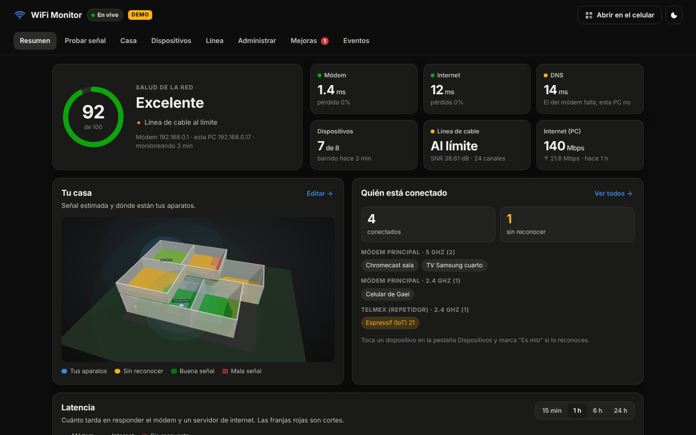
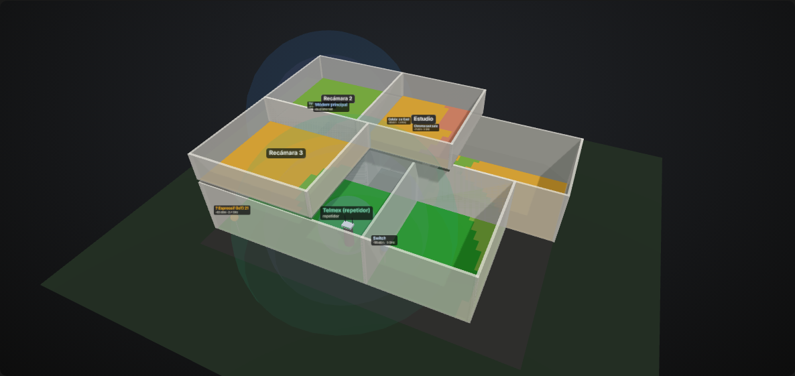
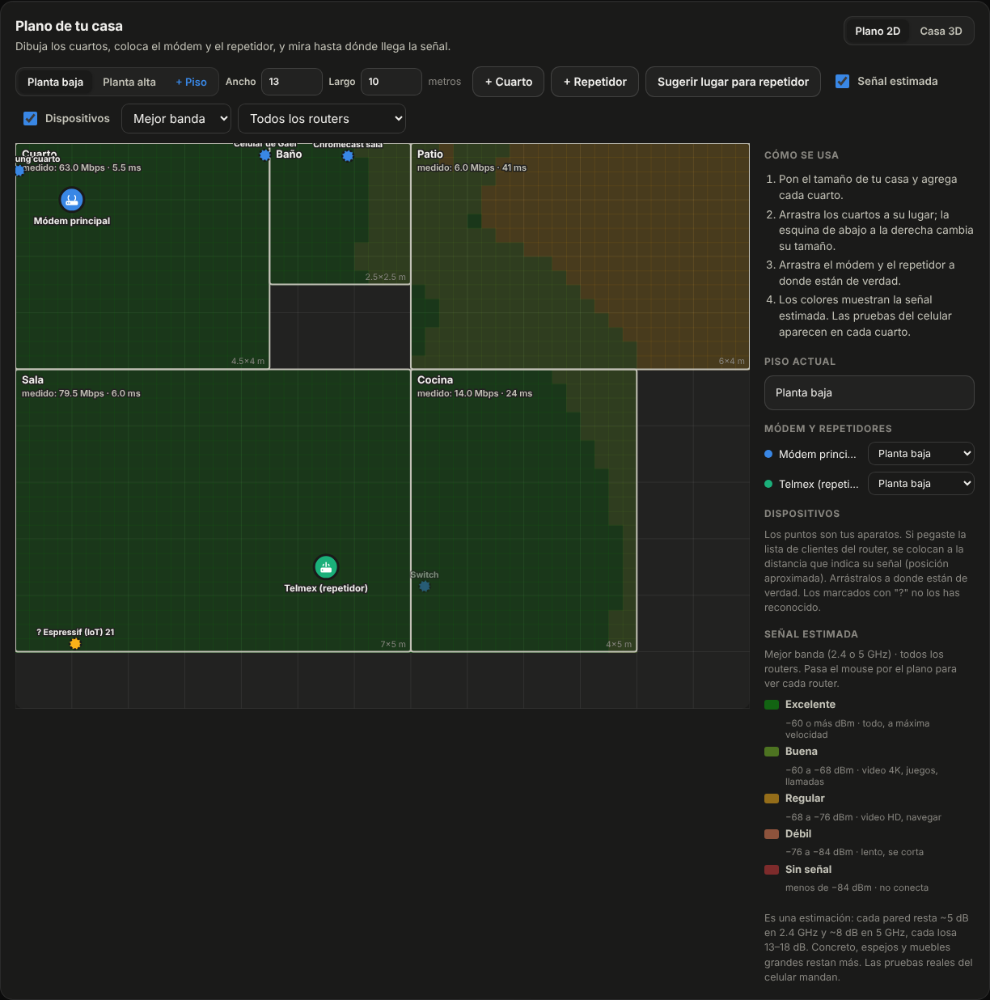
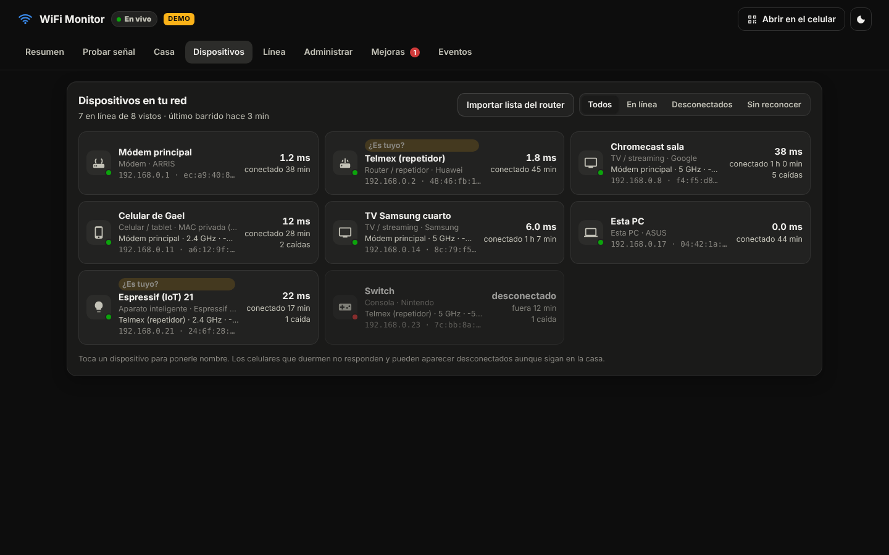
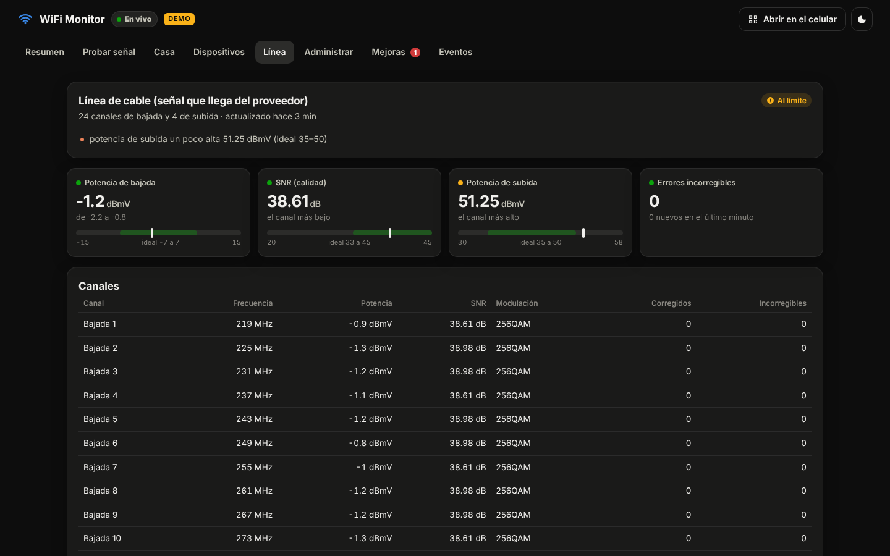
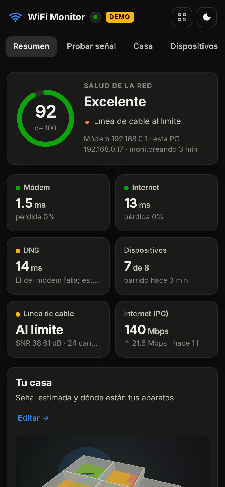
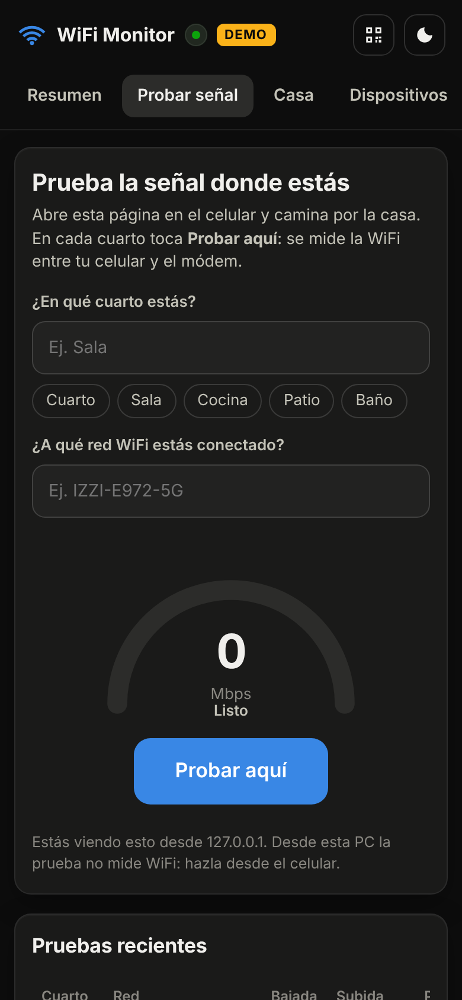

# WiFi Monitor

Panel web para vigilar la red de tu casa: módem, internet, DNS, la línea de cable del proveedor y todos los dispositivos conectados. Se abre en la PC y desde el celular, y con el celular puedes medir la señal cuarto por cuarto.

 

| Resumen | Casa en 3D |
|---|---|
|  |  |
| **Plano con señal estimada y dispositivos** | **Dispositivos** |
|  |  |
| **Línea de cable** | **En el celular** |
|  |   |

*Capturas en modo demostración (`wifimonitor on --demo`).*

## Instalar

Necesitas [Node.js 18 o más nuevo](https://nodejs.org) y [Git](https://git-scm.com).

```bash
git clone https://github.com/GaelCMora/WifiMonitor
cd wifimonitor
npm install
npm link
```

`npm link` deja disponible el comando `wifimonitor` en cualquier terminal. También puedes instalarlo directo sin clonar:

```bash
npm install -g github:GaelCMora/WifiMonitor
```

## Usar

```bash
wifimonitor on       # enciende el monitor y abre el panel
wifimonitor status   # muestra si está encendido y sus direcciones
wifimonitor off      # lo apaga
wifimonitor logs     # abre la carpeta de registros CSV
```

Al encenderlo verás algo así:

```
  WiFi Monitor ● encendido
  En esta PC:     http://localhost:7777
  En tu red:      http://192.168.0.17:7777
  Escanea con el celular (misma WiFi): [código QR]
```

Para abrirlo en el celular, conéctalo a la misma WiFi y escanea el QR (también está en el botón **Abrir en el celular** del panel). La primera vez, Windows preguntará por el Firewall: marca **Redes privadas** y **Permitir**.

Opciones de `wifimonitor on`:

| Opción | Qué hace |
|---|---|
| `--port 7777` | Cambia el puerto |
| `--local` | Solo accesible desde esta PC |
| `--demo` | Datos de ejemplo para ver la interfaz |
| `--foreground` | Corre en la terminal (para ver errores) |
| `--no-open` | No abre el navegador |

## Qué hace

- **Resumen:** calificación de salud de la red, latencia al módem y a internet en vivo con los cortes marcados, DNS, dispositivos y velocidad de internet.
- **Probar señal:** desde el celular, mide bajada, subida, latencia y variación en cada cuarto y con cada red (2.4 GHz, 5 GHz, repetidor).
- **Casa:**
  - Plano 2D de la casa por pisos: dibujas los cuartos y arrastras el módem y los repetidores a donde están.
  - Mapa de señal estimada, que toma en cuenta la distancia, las paredes y los pisos.
  - Sugiere el mejor lugar para poner un repetidor.
  - **Vista 3D** con Three.js.
  - Diagrama de cómo está conectada la red y ranking de señal por cuarto.
- **Dispositivos:** quién está conectado, de qué fabricante es, su latencia, y cuándo y cuántas veces se desconecta. Puedes ponerle nombre, marcar cuáles son tuyos (te avisa si se conecta uno desconocido) e importar la lista de clientes del router para ver su nombre real, a qué router y banda están conectados y con cuánta señal; con eso se ubican aproximadamente en el plano.
- **Línea:** para internet por cable (Izzi, Megacable…), lee la potencia, la SNR y los errores del módem (`192.168.100.1`) y te dice si están en rango.
- **Administrar:** accesos a los paneles de tus routers y guía de dónde está cada opción en tu modelo. Herramientas: ping, traceroute, comparar DNS, limpiar caché DNS y Wake-on-LAN.
- **Mejoras:** recomendaciones calculadas con lo que se midió, por ejemplo:
  - DNS del módem que da respuestas falsas, que es lo que bloquea apps como Steam.
  - Cuartos con señal débil.
  - Línea fuera de rango.
  - Lista de seguridad.
- **Eventos:** historial de caídas, reconexiones y cambios, y descarga de los registros.

Todo se guarda en `~/.wifimonitor` (en Windows: `C:\Users\TU_USUARIO\.wifimonitor`), con un CSV diario por tipo de dato.

## Notas

- La señal estimada del plano es aproximada: usa un modelo por banda: cada pared resta ~5 dB en 2.4 GHz y ~8 dB en 5 GHz, y cada losa entre 13 y 18 dB. Las pruebas reales del celular son las que mandan.
- Los celulares que duermen no responden ping y pueden aparecer como desconectados.
- WiFi Monitor no cambia la configuración de tus routers: te lleva a su panel y te dice qué cambiar.
- Está pensado para la red de tu casa. No lo expongas a internet.

## Licencia

MIT
